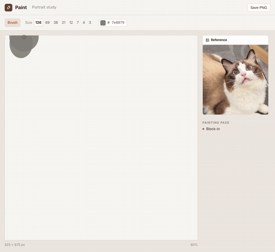

# AI Paint 🎨

把一张照片变成一段“一笔一笔画出来”的视频：从 126 号大笔刷到 3 号细笔，分 4 个阶段（铺色块 → 塑形 → 细化 → 细节），直接导出可以发 X 的高清 MP4。



高清演示视频：[demo/cat_painting.mp4](demo/cat_painting.mp4)

## 原理

用参考照片取色，按笔刷从大到小分层作画，每一笔都下在“画布和原图差别最大”的地方，笔触方向沿着图像的明暗边缘走。思路来自 Aaron Hertzmann 1998 年的论文 *Painterly Rendering with Curved Brush Strokes of Multiple Sizes*。

## 快速开始

需要 Python 3 和 [ffmpeg](https://ffmpeg.org/download.html)。

```bash
pip install playwright
playwright install chromium

python record.py examples/cat.jpg --dur 30 --out painting.mp4
```

大约 3 分钟后得到：

- `painting.mp4`：1312×1200，适合直接发 X
- 加上 `--master` 参数，还会额外输出 1880×1720 的原画质版本

## 不想装环境？

直接用浏览器打开 `paint.html`，把照片拖进去，点 **Start painting**，再用 OBS 或手机录屏就行。

## 进阶：让大模型自己下笔

`ai_painter.py` 会让能看图的大模型（默认 Claude）每一轮观察参考图和当前画布，用工具调用给出一批笔触，最后用 `record.py` 把这些笔触回放成视频。

```bash
pip install anthropic
export ANTHROPIC_API_KEY=你的key
python ai_painter.py examples/cat.jpg --rounds 4 --out strokes.json
python record.py examples/cat.jpg --strokes strokes.json --dur 30 --out ai_painting.mp4
```

想换模型，可以设置环境变量 `PAINT_MODEL`，或者改写 `call_model()` 换成 OpenAI 或 Gemini。

## 调参

| 位置 | 作用 |
|---|---|
| `paint.html` 里的 `SIZES` | 笔刷档位 |
| `TIME_SHARE` | 每层笔刷占视频时长的比例 |
| `planLayer()` 里的阈值 `T` | 越小，细节层下笔越多 |
| URL 参数 `?scale=2` | 画布内部分辨率倍数，越大越清晰、越慢 |

## 文件说明

| 文件 | 作用 |
|---|---|
| `paint.html` | 画板页面、自动作画算法，以及 `window.paint` 接口 |
| `record.py` | 逐帧截图录制，合成高清 MP4 |
| `ai_painter.py` | 由大模型决定每一笔的作画模式 |
| `examples/cat.jpg` | 示例照片（作者自家的布偶猫 🐱） |

## 注意

做真人肖像时，请使用自己拍摄或有权使用的照片。

## License

MIT
